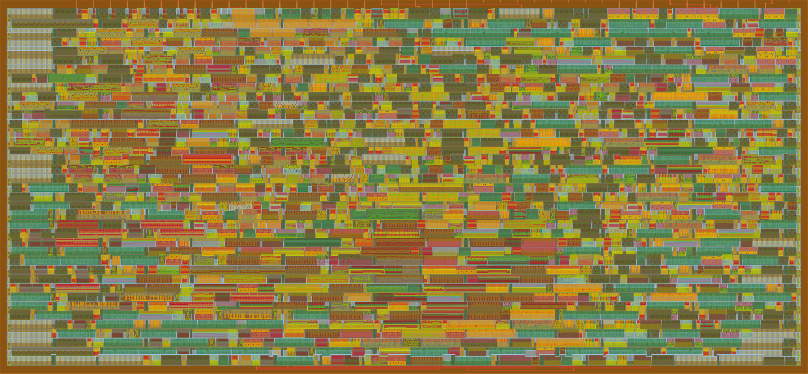
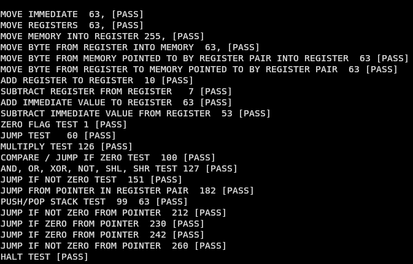
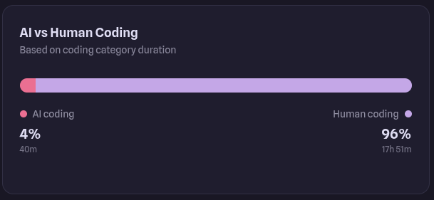
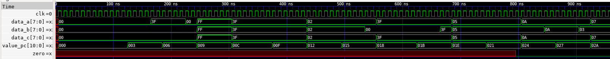

# Prometheus Lite



## Introduction

Prometheus Lite is a custom 8-bit CPU designed and written entirely from scratch in Verilog, and entirely without AI. I started this project intending to take my passion for Computer Science one step further - creating a computer that would actually be manufactured in silicon. I have actually created CPU’s before, Prometheus-1 and Prometheus-2.1 both preceded Prometheus Lite, but both were largely AI assisted and not truly *mine* (on that note, Prometheus Lite doubles as my introduction to Verilog, so the code might not be very good by traditional standards).

Source code and the latest (passing!) workflows can be found at [https://github.com/Gatoware-6310/Prometheus-Lite/](https://github.com/Gatoware-6310/Prometheus-Lite/)

## Architecture

Prometheus Lite features four 8-bit general purpose registers (a, b, c, and d), an 11-bit address bus for addressing up to 2kb of memory, along with an 11-bit program counter and a 24 bit instruction register. There is only one CPU flag, the zero flag.

Each instruction is 3 bytes (24 bits) - one byte for the opcode, another for the first operand, and one last byte for the second operand. An example is:

```asm
movi b, 63
```

This will move the immediate value 63 into the `b` register. In hexadecimal, each byte would be;

0x00 (THE OPCODE)

0x01 (FIRST OPERAND, THE REGISTER TO WRITE TO)

0x3F (SECOND OPERAND, THE IMMEDIATE VALUE TO BE WRITTEN)

### Memory

Currently, the memory interface supports up to 2 kilobytes of synchronous, single port memory. The interface I’m using is intentionally a bit ambiguous until the actual wrappers are released, the entire CPU will be adapted once they are.

Memory can be interfaced either directly or via the stack.

#### The Stack

Prometheus Lite features an empty descending stack, with an 11-bit stack pointer initialized at 0x7FF (the last memory index) that grows downward until it hits 0. There is no memory explicitly reserved for the stack.

Push writes the value of the selected register to the memory address pointed to by the stack pointer, then decrements the stack pointer by 1. Similarly, pop increments the stack pointer by 1, then reads the value at the memory address into the selected register.

### Register Pairs

Prometheus Lite features two native register pairs, ab, and cd. Register pairs are primarily used for 11-bit pointers, essentially concatenating two 8-bit values with big endian ordering.

The instructions that use register pairs are:

`movp [destination register], [pair]` This instruction will move the value pointed to by the register pair into the selected register.

`movfp [pair], [source register]` This instruction will move the value in the selected register into the memory address pointed to by the register pair.

Register pairs are encoded as 0x00, and 0x01, for the first and second register pair.

### Instruction Set

| **Opcode** | **Instruction**                    | **What it does**                                                                                                                                   |
|------------|------------------------------------|----------------------------------------------------------------------------------------------------------------------------------------------------|
| `0x00` | `movi [register], [immediate]` | Moves an immediate value into a selected register                                                                                                  |
| `0x01` | `movr [destination], [source]` | Moves values in between registers                                                                                                                  |
| `0x02` | `mova [address]` | Moves a value from memory into the A register                                                                                                      |
| `0x03` | `movb [address]` | Moves a value from memory into the B register                                                                                                      |
| `0x04` | `movc [address]` | Moves a value from memory into the C register                                                                                                      |
| `0x05` | `movd [address]` | Moves a value from memory into the D register                                                                                                      |
| `0x06` | `movfa [address]` | Moves the value from the A register into memory                                                                                                    |
| `0x07` | `movfb [address]` | Moves the value from the B register into memory                                                                                                    |
| `0x08` | `movfc [address]` | Moves the value from the C register into memory                                                                                                    |
| `0x09` | `movfd [address]` | Moves the value from the D register into memory                                                                                                    |
| `0x0A` | `movp [destination], [pair]` | Moves a value from memory (pointed to by the selected register pair) into the selected register                                                    |
| `0x0B` | `movfp [pair], [source]` | Moves the value from the selected register into the memory address pointed to by the register pair                                                 |
| `0x10` | `add [destination], [source]` | Adds the source register to the destination register                                                                                               |
| `0x12` | `sub [destination], [source]` | Subtracts the source register from the destination register                                                                                        |
| `0x14` | `inc (ASSEMBLER MACRO) [register]` | A macro for add [register], 1                                                                                                                    |
| `0x15` | `dec (ASSEMBLER MACRO) [register]` | A macro for sub [register], 1                                                                                                                    |
| `0x16` | `cmp [destination], [source]` | Subtracts the source register from the destination register, only updating the zero flag and not committing the result to the destination register |
| `0x17` | `addi [register], [immediate]` | Adds an immediate value to the selected register                                                                                                   |
| `0x18` | `subi [register], [immediate]` | Subtracts an immediate value from the selected register                                                                                            |
| `0x19` | `mul [destination], [source]` | Multiplies the destination register by the source register                                                                                         |
| `0x20` | `and [destination], [source]` | Performs a bitwise AND operation on two registers                                                                                                  |
| `0x21` | `or [destination], [source]` | Performs a bitwise OR operation on two registers                                                                                                   |
| `0x22` | `xor [destination], [source]` | Performs a bitwise XOR operation on two registers                                                                                                  |
| `0x23` | `not [register]` | Performs a bitwise NOT operation on a register                                                                                                     |
| `0x24` | `shl [register]` | Shifts the bits in a register left                                                                                                                 |
| `0x25` | `shr [register]` | Shifts the bits in a register right                                                                                                                |
| `0x30` | `jmp [address]` | Jumps to a specific memory address                                                                                                                 |
| `0x31` | `jz [address]` | Jumps to a specific memory address if the zero flag is 1                                                                                           |
| `0x32` | `jnz [address]` | Jumps to a specific memory address if the zero flag is 0                                                                                           |
| `0x35` | `jmpp [pair]` | Jumps to the memory address pointed to by the selected register pair                                                                               |
| `0x36` | `jzp [pair]` | Jumps to the memory address pointed to by the selected register pair if the zero flag is 1                                                         |
| `0x37` | `jnzp [pair]` | Jumps to the memory address pointed to by the selected register pair if the zero flag is 0                                                         |
| `0x40` | `push [register]` | Pushes the contents of the selected register to the stack                                                                                          |
| `0x41` | `pop [register]` | Pops from the stack into the selected register                                                                                                     |
| `0x52` | `nop` | Does nothing!                                                                                                                                      |
| `0x53` | `hlt` | Permanently halts execution                                                                                                                        |

## Implementation

### Modules

Prometheus Lite only has 5 modules:

- The top level: connects all the modules together, defines and cycles through the cpu states, and contains the stack pointer register as well as the zero flag.

- The register file: Contains all 4 general purpose registers (A, B, C, and D)

- The control unit: Executes ALL instructions, including arithmetic operations instead of having a separate ALU

- The program counter: A separate 11-bit register that contains a pointer to the current instruction. This advances by 3 due to 3-byte instructions and byte addressing

- The instruction register: A separate 24-bit register that contains the opcode and two operands of the current instruction

in no particular order.

### States

Prometheus Lite currently has **8** states, mostly dominated by fetching instructions due to the aforementioned memory interface. The states are:

- `FETCH_A`: Starts fetching the first byte of the instruction

- `FETCH_B`: Finishes fetching the first byte, starts fetching the second byte

- `FETCH_C`: Finishes fetching the second byte, starts fetching the third byte

- `FETCH_C_WAIT`: Finishes fetching the third byte and decodes the instruction

- `EXECUTE`: Enables the control unit and executes the instruction

- `WRITEBACK`: Although memory operations can occur during `EXECUTE`, this state allows instructions that require an additional step to complete execution. For example, `movfp` reads the register pair during `EXECUTE`, then writes the value to memory during `WRITEBACK`

- `REGISTER_WRITEBACK`: This is a parallel to `WRITEBACK`, but for registers. For example, `mova` needs to access memory during `EXECUTE`, and writes the result to the A register during `REGISTER_WRITEBACK`. This state also increments the program counter

- `HALT`: This state is only set when the `hlt` instruction is executed, and the CPU stays in this state forever once it reaches it.

These states currently assume 8 bit, synchronous memory. The amount of states will likely be highly optimized once the actual ASIC sram interface is finished and released.

### Execution

#### Instruction Decoding

During the `FETCH_C_WAIT` state once all fetching is done, the 24 bit instruction register is decoded into an opcode and two operands. This is quite flimsy and may not work for some memory designs, so the instruction register, fetching, and decoding in general will likely be optimized and fixed up once a firm memory model is established.

#### Arithmetic and General Execution

Prometheus Lite has no dedicated ALU, arithmetic and bitwise operations are implemented directly in the control unit. After most instructions, the CPU state is explicitly advanced to the next required state for normal execution. For example, `movi` immediately skips to the `REGISTER_WRITEBACK` state as that’s where the program counter is incremented, and there is no extra memory writeback required. For `movfp`, however, the next state is not explicitly set, and instead the cpu naturally falls into the writeback state, which is required because the instruction requires multiple memory accesses.

#### Flags and Branching

Prometheus Lite currently has one flag that can be used for conditional branching, the zero flag. The following instructions can be used for branching/jumping:

- `jmp`: For jumping to an immediate address

- `jz/jnz`: For jumping to an immediate address based on the zero flag

- `jmpp`: For jumping to an address pointed to by a register pair

- `jzp/jnzp`: For jumping to an address pointed to by a register pair based on the zero flag

Jumps are passed into the program counter, and happen on `EXECUTE`.

## Assembler

The assembler is currently a very simple Python script that splits up lines of code and consequently appends the correct hexadecimal values for the opcode and operands, which then gets written to a binary file and a hex file (for Verilog simulations). An example of a program and its assembler output is:

Program:

```asm
movi a, 120
movi b, 120
sub a, b
```

Hex:

```text
00 00 78
00 01 78
12 00 01
```

Binary:

```text
00000000 00000000 01111000
00000000 00000001 01111000
00010010 00000000 00000001
```

## Tests

Prometheus Lite’s functionality is tested through one testbench that initializes the CPU’s memory with lots of instructions, then lets the CPU naturally execute and see if the registers, program counter, instruction register, stack pointer, and memory values align with the expected values. If they do, tests pass, if not, tests fail.



## Time spent

According to Hackatime, I spent around 28 hours in total on this project specifically, 40 minutes of which being AI usage. I must emphasize that I did *not* use AI for generating CPU code - I initially used an AI generated Makefile which I replaced soon after, and the rest of the AI usage is primarily from asking questions to help me learn (NOT copy pasting), or problems with hackatime (I’ve noticed that even leaving something AI related open in the background seems to contribute to the final count, which is odd).



Although, I don’t think hackatime is accounting for *everything*. I’d say I spent about 5-6 hours more in total just designing the CPU in my head, thinking about the ISA, even writing this document explaining it - bringing the final count up to a rough estimate of about 32 and a half hours.

## What I Learned and Where I Went Wrong

Throughout my time developing Prometheus Lite, I seriously refined my knowledge on exactly how computers work at the lowest level - the added constraint of not vibecoding whatsoever made it much more fun, drawn out, and educational than I initially anticipated, and even rekindled my love for programming entirely on my own in a way. 

That being said, the development cycle was not without its failures. Since this was technically my first Verilog design, I consistently (especially in the early stages) had to fight through millions of confusing syntax errors (my Verilog linter in VSCode is a bit broken) only to find that a test was failing anyway. It took me a long time to debug these sorts of errors, but I got through it. 

Despite that, the feeling of victory when I finally realized what was going wrong or exactly how to make something work that I'd been staring at for an hour always outweighed the failures. Now, I've had similar feelings for almost all of my other projects, but this one is different. I think that this is by far the hardest thing I've ever done, my greatest accomplishment, and the culmination of all my CS related efforts thus far. 

In summary, I learned a lot from the development of Prometheus Lite, including exactly what makes a computer tick, how to write Verilog, and exactly how chip design works internally, a point I never thought that I would reach myself!

## Conclusion, Notes and Next Steps

- This design is absolutely not final, but I’ve done pretty much everything I can in digital simulations for now. At this point, I’m going to submit the project, and refine it/add more features/optimize it as soon as I get the FPGA.

- I want to add a way to interface with external devices, so, inspired by x86, I will likely implement `in/out` instructions once I get the FPGA and everything related to the actual ASIC is finalized.

- On the final ASIC design, I intend to add some silicon art. I've done research, and Tiny Tapeout seems to support it!

- This design **does** work with GTKWave, and produces the expected signals, as shown below.
  

Thank you for reading!!!!
